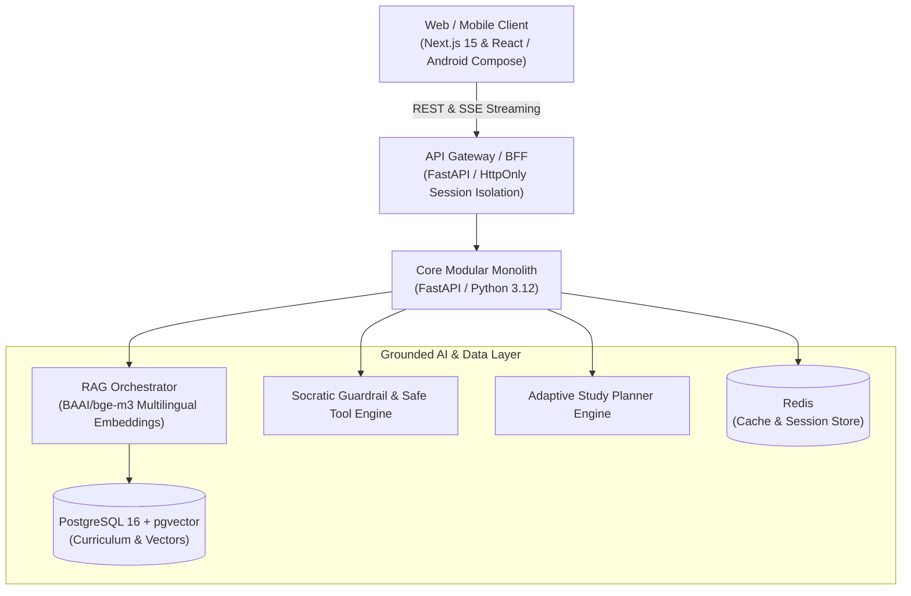

# ThinkBuddy (টিঙ্কবাডি) 🎓

> **A Grounded, Socratic Personal Learning Companion for Bengali-speaking Students**  
> *Developed for AI Congress 2026 by Team Thinking*

[](LICENSE)
[](https://python.org)
[](https://fastapi.tiangolo.com)
[](https://nextjs.org)
[](https://github.com/pgvector/pgvector)
[]()

---

## 📹 Video Presentation & Demo

Watch or download our complete 3-minute video presentation and system walkthrough:
- **Direct Video Download & Release:** [ThinkBuddy AI Congress Submission Video (v1.0.0)](https://github.com/nmtaief/ThinkBuddy/releases/tag/v1.0.0)
- **Local File Path:** `ThinkBuddy_AI_Congress_Submission.mp4`

---

## 🌟 The Problem
High school students in Bangladesh face acute learning challenges:
1. **Scattered Learning Stack:** Students juggle disconnected coaching centers, private tutors, unverified guidebooks, and generic LLM chatbots that hallucinate or leak answers.
2. **Untracked Knowledge Gaps:** Exam failures stem from undetected foundational misunderstandings in earlier chapters rather than lack of effort.
3. **Burnout & Inconsistent Routine:** Late-night cramming without structured revision leads to fatigue and poor retention.

---

## 💡 The Solution: 3 Core Pillars

ThinkBuddy unifies learning into a safe, curriculum-grounded ecosystem:

```
┌────────────────────────────────────────────────────────────────────────┐
│                              ThinkBuddy                                │
│        A Personal Learning Companion for Bengali-speaking Students     │
└────────────────────────────────┬───────────────────────────────────────┘
                                 │
     ┌───────────────────────────┼───────────────────────────┐
     ▼                           ▼                           ▼
┌──────────────────┐    ┌──────────────────┐    ┌──────────────────┐
│     PILLAR 1     │    │     PILLAR 2     │    │     PILLAR 3     │
│ Diagnose Weakness│    │ Grounded AI Tutor│    │ Adaptive Planner │
│ (দুর্বলতা নির্ণয়) │    │  (নির্ভুল গাইড)  │    │  (স্মার্ট রুটিন)  │
├──────────────────┤    ├──────────────────┤    ├──────────────────┤
│• Practice Quizzes│    │• Socratic Method │    │• 50m / 10m Cycles│
│• Why-Taxonomy    │    │• Textbook Pages  │    │• 7h Sleep Window │
│• Chapter Mastery │    │• Bilingual Hints │    │• Exam Micro-Plan │
│• Error Root Cause│    │• Zero Answer Leak│    │• Growth UX       │
└──────────────────┘    └──────────────────┘    └──────────────────┘
```

1. **Pillar 1: Diagnose Weakness (`দুর্বলতা চিহ্নিতকরণ`)**
   - Pinpoints exact marks lost and maps errors to a structured "Why-Sheet" taxonomy (conceptual misunderstanding vs. calculation slip vs. reading error).
   - Chapter- and topic-level mastery heatmaps.

2. **Pillar 2: Grounded AI Teacher (`পাঠ্যবই নির্ভুল শিক্ষক`)**
   - Strict Socratic pedagogy: asks guiding questions and provides hints; **never leaks raw answers or solution keys**.
   - Dual-language support: full native Bengali and English support.
   - Exact physical textbook citations (printed book page and chapter).

3. **Pillar 3: Adaptive Planner (`স্মার্ট দৈনিক সময়সূচি`)**
   - Dynamic schedule built around weak areas, school hours, and upcoming exam dates.
   - Enforces a mandatory **7-hour sleep window** and 50-minute study + 10-minute break Pomodoro intervals.
   - Adaptive replanning when sessions are missed without guilt or burnout.

---

## 🏗️ System Architecture



---

## 🛡️ Security, Privacy & Integrity Guarantees

- **Server-Side Authority:** Quiz timing, scoring, question selection, and answer keys reside exclusively on the server. Answer keys are **never sent to the client** before submission.
- **Client Storage Isolation:** No authentication tokens are stored in browser-accessible storage (`localStorage` / `sessionStorage`). Sessions are managed strictly via `HttpOnly`, `SameSite=Lax`, `Secure` cookies.
- **Assessment Isolation:** Assessed high-stakes exams enforce native platform attestation and are restricted on web clients (`WEB_PLATFORM_PRACTICE_ONLY`).
- **Grounded Citations:** Every retrieved textbook fact references the printed physical page number rather than raw PDF indices.

---

## 🚀 Quickstart & Local Setup

### Prerequisites
- Python 3.12+
- Node.js 20+ & npm
- Docker & Docker Compose

### 1. Boot Infrastructure (PostgreSQL + pgvector & Redis)
```bash
docker compose up -d postgres redis
```

### 2. Backend Setup
```bash
python -m venv .venv
source .venv/bin/activate  # On Windows: .venv\Scripts\activate
pip install -e .
alembic upgrade head
uvicorn core.main:app --host 0.0.0.0 --port 8000 --reload
```

### 3. Frontend Setup
```bash
cd web
npm install
npm run dev
```
Open [http://localhost:3000](http://localhost:3000) to view the student dashboard, today's schedule, and the Socratic AI companion.

---

## 👥 Team Thinking

- **Project:** ThinkBuddy (টিঙ্কবাডি)
- **Target Audience:** Bengali-speaking secondary students (NCTB Curriculum)
- **Submission:** AI Congress 2026
- **Repository:** [https://github.com/nmtaief/ThinkBuddy](https://github.com/nmtaief/ThinkBuddy)
