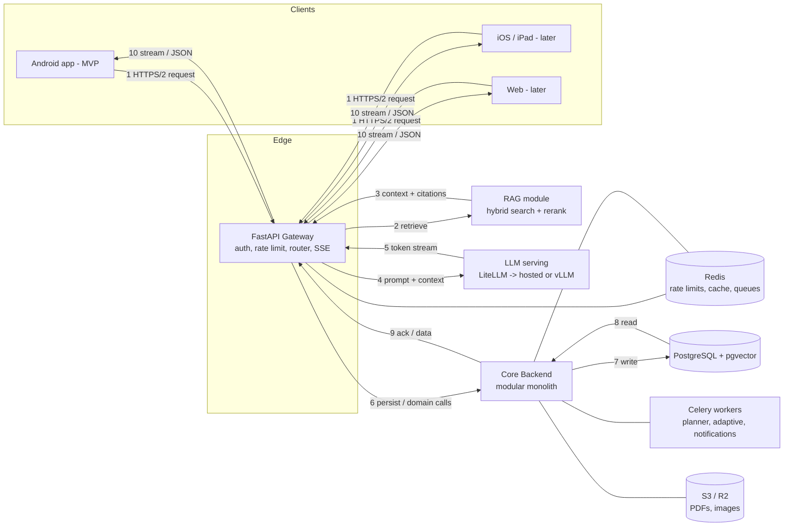

# 01 – Architecture

## 1. Goals
- One backend serving Android phone, Android tablet, iPhone, iPad, and web, with no per-platform forks.
- Grounded, cited answers (RAG) over NCTB textbooks.
- A learning loop that adapts daily: plan → study → quiz → review → revise.
- Secure assessment on the server side, with client hardening as an extra layer.
- Beta scope: **Student + Parent**. Teacher is built but flagged off.

## 2. System diagram

Your two sketches are kept: gateway in the centre, RAG + LLM on one side, backend + DB on the other.
Two clarifications so Antigravity does not misread them:

- **Streaming starts at step 5, not 10.** Tokens are forwarded to the client as they arrive. Steps 6–9 (saving the message, updating weak-point signals) run after or alongside the stream and must never block it.
- **The gateway stays thin.** It authenticates, rate-limits, routes, and runs the *chat orchestrator* (the only code that talks to RAG + LLM). All other business rules live in the core backend.

## 3. Stack (final choices)

| Layer | Choice | Notes |
|---|---|---|
| Android client | Kotlin, Jetpack Compose, Material 3, Hilt | Adaptive layouts via `WindowSizeClass` for phone + tablet |
| Networking | Retrofit + OkHttp (HTTP/2), SSE for streaming | Retry with idempotency keys on writes |
| Local | Room (offline cache of plan/tasks), DataStore (settings, tokens) | Quiz answers are never cached as "correct" locally |
| Gateway | FastAPI, Python 3.12, Uvicorn + uvloop | |
| Auth | Firebase Auth (phone OTP, Google) behind `AuthProvider` | Gateway verifies token, loads internal user + role |
| Rate limiting | slowapi + Redis, per user, per IP, per route class | Chat and quiz-submit have their own limits |
| Core backend | FastAPI, SQLAlchemy 2.0, Alembic, Pydantic v2 | Modular monolith |
| Jobs | Celery + Redis (or Arq if you want lighter) | Nightly adaptive run, plan regeneration, push |
| RAG | LlamaIndex *or* a small custom pipeline | Prefer a small custom pipeline for control of citations |
| Embeddings | Multilingual (`bge-m3` / `multilingual-e5` / hosted) | Must pass Bangla retrieval eval |
| Retrieval | Hybrid: vector + BM25/trigram, then reranker | Filter by class, subject, book, chapter |
| LLM | LiteLLM → hosted frontier model; vLLM later if cost demands | Model chosen per task (chat, grading, generation) |
| DB | PostgreSQL 16 + pgvector | `VectorStore` interface for later Qdrant swap |
| Cache/queue | Redis 7 | |
| Files | S3 or Cloudflare R2 | Signed URLs only |
| Push | FCM (Android + web), APNs via FCM for iOS | `devices` table stores tokens |
| Deploy | Docker Compose → single VM (Hetzner/DO) → managed later | Caddy or Nginx, Cloudflare in front |
| Observability | OpenTelemetry, Prometheus/Grafana or hosted, Sentry | Request IDs end to end |

## 4. Backend modules (core)
`auth` · `families` (parent–student links, consent) · `curriculum` (books, chapters, concepts, chunks) · `planner` · `questions` · `quiz` (secure engine) · `reviews` (teacher, flagged) · `chat` (history, usage) · `progress` (mastery, signals) · `revision` · `notifications` · `devices` · `entitlements` (free/premium) · `admin` (content, flags) · `audit`.

Rules: modules talk through service interfaces, not each other's tables. Each module owns its tables.

## 5. Multi-platform strategy ("dynamic backend")
The backend never branches on platform. Instead:

1. **Versioned REST API** (`/v1`) with an OpenAPI schema. Clients for Kotlin, Swift, and TypeScript are generated from it.
2. **Client identity headers** on every request: `X-Client-Platform` (android|ios|web), `X-Client-Form-Factor` (phone|tablet|desktop), `X-App-Version`, `X-Device-Id`, `Accept-Language`.
3. **`GET /v1/client/config`** returns server-driven settings: minimum supported version, feature flags, entitlements, quiz-security mode allowed for this platform, polling intervals, and layout hints (e.g., "dashboard cards order"). Clients render from it. This is how one backend behaves differently per platform without code forks.
4. **Responsive payloads.** Content payloads are structured (blocks of text, formulas, images, citations), not pre-rendered HTML, so each client renders natively.
5. **Push abstraction.** One `notifications` module, with per-device channel (FCM/APNs/web push).
6. **Streaming fallback.** SSE is primary. If a client/proxy cannot stream, `POST /v1/chat/messages?stream=false` returns the full answer.
7. **Pagination, idempotency, and ETags** everywhere, so flaky mobile networks behave.

## 6. Chat request flow (steps 1–10)
1. Client sends message (+ optional `document_context`: the book/page the student is viewing).
2. Gateway validates token, rate limit, entitlement, and daily quota. Orchestrator classifies the query (study question / quiz-integrity risk / off-topic / unsafe).
3. **Integrity check:** if the message arrives during an active secure quiz attempt, refuse and log an integrity event (see `05_SECURE_QUIZ.md`).
4. RAG retrieves top chunks, filtered by student's class/subject/(current chapter boosted).
5. If top score is below threshold → answer "I couldn't find this in your textbook" with a suggested chapter, instead of guessing.
6. Orchestrator builds the prompt (system rules + student level + language + retrieved chunks) and calls the LLM; tokens stream to client as SSE events.
7. Final event includes citations (book, chapter, printed page, chunk id).
8. After stream: backend stores message, citations, and token usage; a background task extracts a **weak-point signal** (topic asked about, repeated asks, confusion markers).
9. Daily quota and analytics updated in Redis/Postgres.
10. Client can fetch history from `GET /v1/chat/sessions/{id}`.

## 7. Non-functional targets (beta)
- First token < 2.5 s p95 on mobile data; non-chat API p95 < 400 ms.
- Chat answers always carry citations or an explicit "not found" state.
- Zero answer-key leakage before submission (automated test).
- Works on 3G-grade connections: small payloads, resumable requests, offline view of today's plan.
- Data protection: encryption at rest and in transit, parental consent recorded, minimal data on minors, audit log for parent/teacher access.

## 8. Risks to watch
- **Bangla quality** in embeddings and LLM output → build an evaluation set early (P02/P05).
- **LLM cost** → quotas per plan, caching of identical retrieval, cheaper model for classification.
- **Hallucinated quiz questions** → generated questions must be grounded in a chunk, validated by a second pass, and tagged `ai_generated` (see `06_ADAPTIVE_ENGINE.md`).
- **OCR errors** from the Knowledge Factory → ingest only chunks passing validation flags.
